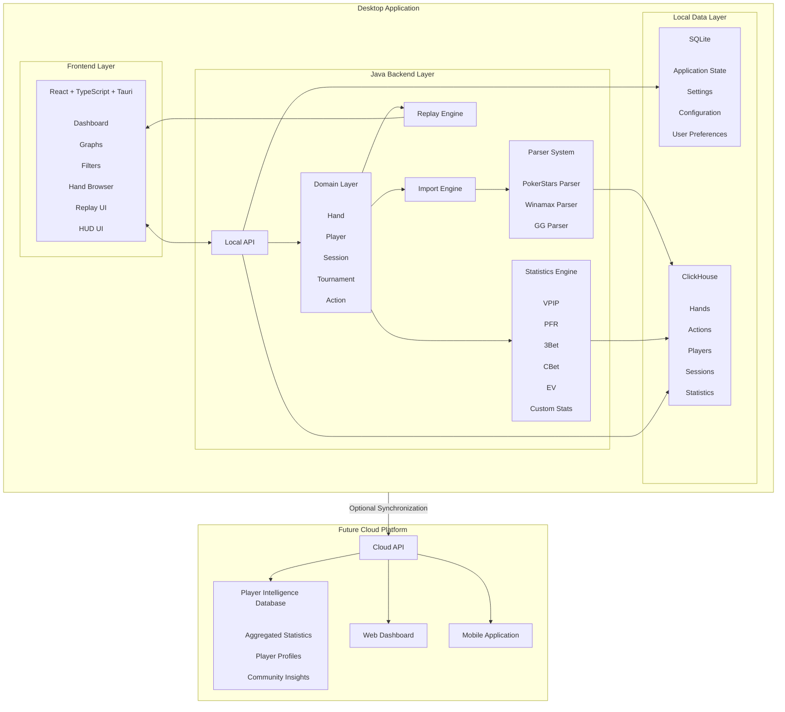
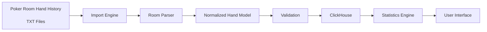

# Poker Analytics Platform - Architecture

## 1. Overview

This document defines the high-level architecture of the Poker Analytics Platform.

The application is designed as a **local-first desktop application** with future cloud capabilities.

The main objectives are:

- Support millions of poker hands efficiently.
- Provide a modern cross-platform desktop experience.
- Keep user data private and under user control.
- Separate UI, business logic and data storage.
- Allow future evolution into a cloud-connected poker intelligence platform.

---

# 2. Architecture Diagram



---

# 3. Architecture Principles

## 3.1 Local First

The desktop application is the primary environment where users manage and analyze their poker data.

The application must work completely without an internet connection.

The cloud is an optional extension that provides additional functionality:

- Synchronization.
- Backup.
- Web dashboard.
- Mobile access.
- Community intelligence.

The user should always be able to analyze their own data locally.

---

## 3.2 Data Ownership

Users own their raw poker data.

The local application stores:

- Imported hand histories.
- Players.
- Actions.
- Results.
- Statistics.

The cloud should not be required for the core product experience.

Future cloud services will focus on adding value without taking ownership of the user's raw data.

---

## 3.3 Source of Truth

Raw hand information is the source of truth.

Statistics are derived information.

The data flow should be:

```
Raw Hand History

        ↓

Parser

        ↓

Normalized Hand Model

        ↓

Database Storage

        ↓

Statistics Engine

        ↓

Reports / Graphs / Insights
```

All statistics should be recalculable from the original hand data.

This allows:

- Improving calculations in future versions.
- Adding new statistics.
- Fixing bugs without losing information.

---

## 3.4 Separation of Responsibilities

Each component must have a clear responsibility.

The system is divided into:

- Presentation layer.
- Business logic layer.
- Data processing layer.
- Storage layer.
- External integrations.

The UI should not contain business rules.

The database should not contain application logic.

---

# 4. Technology Stack

## Desktop Application

### Technologies

- Tauri
- React
- TypeScript

### Responsibilities

The frontend handles:

- User interface.
- Navigation.
- Visualization.
- Charts.
- Filters.
- Replay visualization.
- User interactions.

---

# Backend

## Technologies

- Java
- Spring Boot

## Responsibilities

The backend handles:

- Business logic.
- Import processing.
- Parsing orchestration.
- Statistics calculations.
- Replay generation.
- Data access.

---

# Analytical Database

## Technology

- ClickHouse

## Purpose

ClickHouse is used for poker analytical data.

It is optimized for:

- Large datasets.
- Aggregations.
- Filtering.
- Statistical calculations.

It stores:

- Hands.
- Actions.
- Players.
- Sessions.
- Statistics.
- Aggregated data.

---

# Application Database

## Technology

- SQLite

## Purpose

SQLite stores application-specific information.

Examples:

- User preferences.
- Application configuration.
- Import history.
- UI state.
- Local settings.

SQLite is selected because:

- It requires no external server.
- It is lightweight.
- It is ideal for desktop applications.

---

# 5. Database Strategy

The application uses two databases because they solve different problems.

## SQLite

Transactional application data.

Examples:

```
Settings

Configuration

Preferences

Imported files

Application state
```

---

## ClickHouse

Analytical poker data.

Examples:

```
Hands

Players

Actions

Cards

Boards

Sessions

Statistics

Aggregations
```

---

This separation allows each database to be optimized independently.

---

# 6. Data Import Flow

The import process works as follows:



---

# 7. Backend Module Architecture

The Java backend should be modular.

Initial structure:

```
backend/

├── poker-domain

├── poker-parser

├── poker-importer

├── poker-statistics

├── poker-replay

├── poker-storage

└── poker-api
```

---

## poker-domain

Contains the core business entities.

Examples:

- Hand.
- Player.
- Action.
- Session.
- Tournament.
- Statistics.

This module should not depend on infrastructure.

---

## poker-parser

Responsible for converting poker room formats into a common internal model.

Supported rooms:

- PokerStars.
- Winamax.
- GGPoker.
- Future rooms.

Architecture:

```
Parser Interface

        |

        ├── PokerStars Parser

        ├── Winamax Parser

        └── GG Parser
```

---

## poker-importer

Responsible for:

- Reading files.
- Detecting duplicates.
- Managing imports.
- Triggering parsing.

---

## poker-statistics

Responsible for calculating:

- VPIP.
- PFR.
- 3Bet.
- Fold frequencies.
- CBet.
- Win rate.
- EV.
- Custom statistics.

---

## poker-replay

Responsible for converting stored hand data into a visual replay.

Input:

```
Cards

Actions

Board

Players

Pot information
```

Output:

```
Interactive Hand Replay
```

---

## poker-storage

Responsible for:

- SQLite repositories.
- ClickHouse repositories.
- Database access.

---

## poker-api

Provides communication between:

- React frontend.
- Java backend.

---

# 8. Frontend Structure

Initial React structure:

```
frontend/

src/

├── dashboard

├── hands

├── replay

├── statistics

├── players

├── settings

├── components

└── services
```

---

# 9. Future Cloud Architecture

The future cloud system will extend the local application.

Architecture:

```
Desktop Application

        ↓

Synchronization Service

        ↓

Cloud API

        ↓

Cloud Database

        ↓

Web / Mobile Applications
```

---

The cloud will initially store:

- Session summaries.
- Statistics.
- Aggregated player profiles.
- User preferences.

The cloud will not initially store complete hand histories.

---

# 10. Future Player Intelligence Network

A future product differentiator is a community intelligence system.

Concept:

```
User A Data

+

User B Data

+

User C Data

        ↓

Aggregated Intelligence

        ↓

Advanced Player Profiles
```

The system should prioritize:

- Aggregated statistics.
- Privacy.
- User control.

---

# 11. Architectural Decisions

## ADR-001: Local First Architecture

Status:

Accepted

Reason:

- Better performance.
- Offline capability.
- Lower infrastructure costs.
- Better privacy.

---

## ADR-002: SQLite + ClickHouse

Status:

Accepted

Reason:

SQLite is optimized for application state.

ClickHouse is optimized for analytical workloads.

Using both databases provides the best balance between simplicity and performance.

---

## ADR-003: Desktop First

Status:

Accepted

Reason:

Most poker players use desktop environments while playing.

The desktop application provides:

- Maximum performance.
- Access to local hand histories.
- HUD capabilities.
- Replay functionality.

Cloud and mobile features will be developed later.

---

# 12. Initial Non Goals

The first version will NOT include:

- Cloud synchronization.
- Mobile application.
- Community player database.
- AI coaching.
- Global opponent intelligence.

These features will be added after the local tracker is mature.