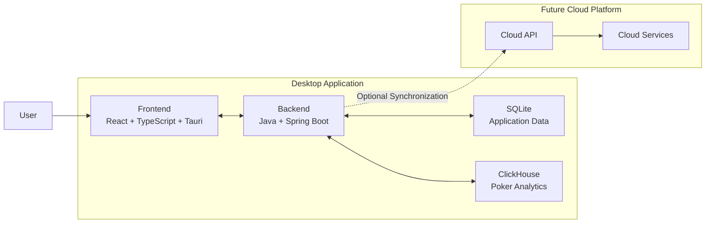

# Poker Analytics Platform - System Architecture

## 1. Overview

This document describes the high-level architecture of the Poker Analytics Platform.

The application is designed as a **local-first desktop application** with an architecture that prioritizes performance, maintainability, scalability and future cloud integration.

The architecture separates the system into independent layers with clearly defined responsibilities, allowing each component to evolve without affecting the rest of the platform.

Detailed backend and frontend architectures are documented separately.

---

# 2. Architectural Goals

The system has been designed to achieve the following objectives:

- Support millions of poker hands efficiently.
- Deliver a modern desktop experience on Windows, Linux and macOS.
- Keep user data under the user's control.
- Maximize analytical query performance.
- Maintain a clean separation of responsibilities.
- Enable future cloud synchronization without impacting the local-first philosophy.
- Allow the platform to evolve over many years.

---

# 3. High-Level Architecture



---

# 4. System Components

## Frontend

Technology:

- React
- TypeScript
- Tauri

Responsibilities:

- User interface
- Navigation
- Data visualization
- Charts
- Filters
- Hand replay visualization
- User interaction

The frontend contains no business logic.

---

## Backend

Technology:

- Java
- Spring Boot

Responsibilities:

- Business logic
- Import orchestration
- Poker hand processing
- Statistics generation
- Replay generation
- Data access
- Communication with external services

The backend acts as the central application layer.

---

## Analytical Database

Technology:

- ClickHouse

Purpose:

Store and process poker analytical data.

Examples include:

- Hand histories
- Player information
- Actions
- Sessions
- Aggregated statistics

The database is optimized for analytical queries over very large datasets.

---

## Application Database

Technology:

- SQLite

Purpose:

Store application-specific information.

Examples include:

- User preferences
- Configuration
- Import history
- UI state
- Local application settings

SQLite provides a lightweight embedded database suitable for desktop applications.

---

## Future Cloud Platform

The cloud platform is an optional extension of the desktop application.

Potential responsibilities include:

- User synchronization
- Backup
- Web dashboard
- Mobile access
- Community intelligence
- Future AI services

The cloud is never required for the core desktop experience.

---

# 5. Architectural Principles

## Local First

The desktop application is the primary product.

Users should always be able to import, analyze and review their poker data without an internet connection.

Cloud functionality is optional.

---

## Separation of Responsibilities

Each architectural layer has a clearly defined responsibility.

Presentation, business logic and data storage remain independent.

---

## Single Source of Truth

Raw hand histories are the authoritative source of information.

All derived information, including statistics, reports and graphs, must be reproducible from the original hand data.

---

## Analytics-Oriented Design

The application is designed as an analytical platform rather than a transactional system.

Architecture decisions prioritize:

- Fast filtering
- Large aggregations
- Statistical analysis
- Efficient reporting

---

## Extensibility

The architecture should allow future additions without major redesigns.

Examples:

- New poker rooms
- New statistics
- New visualizations
- Cloud synchronization
- AI modules
- Community intelligence

---

# 6. Data Flow

The system processes poker data through several logical stages.

```text
Poker Room

↓

Hand History Files

↓

Import Engine

↓

Parser

↓

Normalized Domain Model

↓

Local Storage

↓

Analytics Engine

↓

User Interface
```

Each stage has a single responsibility and communicates through well-defined interfaces.

---

# 7. Database Strategy

The platform uses two complementary databases.

## SQLite

Optimized for transactional application data.

Stores:

- Configuration
- Preferences
- UI state
- Import metadata

---

## ClickHouse

Optimized for analytical poker data.

Stores:

- Poker hands
- Player actions
- Sessions
- Analytical information
- Aggregated metrics

Each database is used according to its strengths.

---

# 8. Future Evolution

The architecture has been designed to support future expansion.

Planned extensions include:

- Cloud synchronization
- Shared player intelligence
- Web application
- Mobile application
- AI-assisted analysis
- Community-driven statistics

These features should integrate naturally without requiring major architectural changes.

---

# 9. Related Documentation

This document provides a high-level overview only.

Detailed design is described in the following documents:

- `05-product-map.md`
- `06-query-catalog.md`
- `07-analytics-engine.md`
- `08-storage-strategy.md`
- `09-data-model.md`
- `10-api-design.md`
